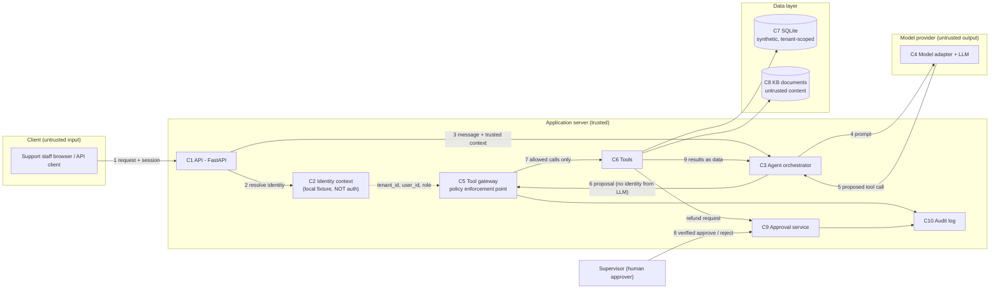
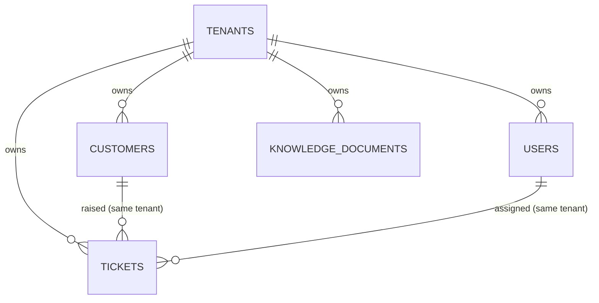

# Architecture

> **Status (Session 7 baseline, tag `v0-baseline`):** C1–C10 are implemented except real authentication,
> a persistent audit store and the tenant-admin user-management path. See the component table and §8–§13.
> *Original Session 1 note, kept for history:* Design only (Session 1). Apart from the `/health` endpoint, every component
> below is **planned, not implemented**. Control status values are used throughout:
> **Planned → Implemented → Tested**. Today every control is *Planned*.

## 1. Purpose and scope

A local, multi-tenant customer support agent for two fictional insurers. Support staff
chat with an AI agent that can read and update customer records, search a knowledge base,
draft emails and raise refund requests — all on synthetic data.

The security design rests on one idea: **the LLM is an untrusted component.** It can
*propose* actions. It cannot *authorise* them. See [ADR-001](decisions/ADR-001.md).

## 2. Actors

| Actor | Description | Trust |
|---|---|---|
| Support agent | Tenant staff member handling tickets via the agent | Authenticated (simulated), least privilege |
| Supervisor | Tenant staff member; approves refunds | Authenticated (simulated), elevated for approvals |
| Tenant admin | Manages tenant configuration and users | Authenticated (simulated), admin scope only |
| End customer (indirect) | Never uses the system directly; their text arrives via tickets | **Untrusted** content source |
| KB author (indirect) | Content in KB documents may be stale, wrong or malicious | **Untrusted** content source |
| LLM | Plans responses and proposes tool calls | **Untrusted** output |
| Developer / operator | Runs the lab locally | Trusted, out of band |
| Attacker | Malicious tenant user, or anyone able to plant text in tickets/KB | Hostile |

## 3. Components

| # | Component | Responsibility | Status |
|---|---|---|---|
| C1 | API (FastAPI) | HTTP entry point; request validation (Pydantic) | `/health`, `/audit-demo` (Session 3); `/chat` with the Claude agent when `AGENT_PROVIDER=anthropic`, else a fixed reply (Session 6); see §10, §13 |
| C2 | Identity context | Resolves the caller to `{user_id, tenant_id, role}` **server-side**. In the lab this is a local fixture, **not authentication** | Dev fixture implemented + unit-tested (Session 2); not wired to the API |
| C3 | Agent orchestrator | Builds prompts, calls the model, receives proposed tool calls | Implemented + mock-tested (Session 6, `app/agent/runtime.py`); see §13 |
| C4 | Model adapter | Single interface to a model provider | Implemented (Session 6): Anthropic Claude via `anthropic==2.5.0`; offline-transport tested; live runs pending |
| C5 | Tool gateway (policy enforcement point) | Validates tool arguments, injects identity from C2, applies the permission matrix, then dispatches | Implemented + tested at function level for all 5 tools (Sessions 4–5); not reachable over HTTP yet; see §11–12 |
| C6 | Tools | `read_customer`, `update_customer`, `search_kb`, `draft_email`, `request_refund` | All five implemented + tested at function level (Sessions 4–5); not exposed over HTTP or to an LLM |
| C7 | Data store (SQLite) | Tenant-scoped synthetic data | Schema + fixtures implemented + tested (Session 2); see §8 |
| C8 | KB retrieval | Tenant-scoped document search; results returned as **data** | Implemented + tested (Session 5, `search_kb`); keyword search only |
| C9 | Approval service | Records refund requests; requires a verified supervisor decision | Implemented + tested as a simulated in-process service (Session 5, `app/approvals.py`); no UI/HTTP |
| C10 | Audit log | Records who/what/when/decision; excludes secrets and unnecessary personal data | Structured events + metadata allow-list implemented + tested (Session 3); written to stderr only, no persistent store |

## 4. Architecture diagram



## 5. Data flows

1. **Request:** client sends a message with a session reference to the API (C1).
2. **Identity:** C1 resolves the session to `{user_id, tenant_id, role}` via C2. This is the
   *only* source of identity for the rest of the request.
3. **Orchestration:** C3 receives the user message plus the trusted context.
4. **Model call:** C3 sends the prompt to the model (C4). Tenant identifiers need not be
   given to the model at all.
5. **Proposal:** the model returns text and/or a *proposed* tool call with arguments.
6. **Enforcement:** C5 discards any identity- or tenant-like arguments from the proposal,
   validates the remaining arguments against a schema, takes identity from C2, and checks
   the permission matrix (§7) and resource ownership (record belongs to caller's tenant).
7. **Execution:** only allowed calls reach C6. Data access is filtered by the server-side
   `tenant_id`.
8. **Approval:** `request_refund` creates a *pending* request only. A supervisor of the same
   tenant, verified by C2, approves or rejects it outside the model loop.
9. **Results:** tool output (including retrieved KB text and ticket text) goes back to C3
   marked as untrusted data, never as system instructions.

Every decision in steps 6–8, allowed or denied, is written to the audit log (C10).

## 6. Trust boundaries

| ID | Boundary | What crosses it | Key concern |
|---|---|---|---|
| TB1 | Client → API | User messages, session reference | Spoofed identity, malformed input |
| TB2 | Orchestrator ↔ Model | Prompts out; text + proposed tool calls in | Model output is attacker-influenceable (prompt injection) |
| TB3 | Tool gateway → Tools / Data | Authorised calls | Cross-tenant access, excessive agency |
| TB4 | Retrieved content → Prompt context | KB documents, ticket text, customer notes | Indirect prompt injection |
| TB5 | Human approver → Approval service | Approve/reject decisions | Forged or self-approval |
| TB6 | Application → Audit log | Event records | Leakage of secrets or personal data into logs |

## 7. Permission matrix

> **Enforcement status (Session 5):** all tool rows plus refund approve/execute are enforced in code by
> [app/authz.py](../app/authz.py) (role) together with tenant-scoped repositories and the approval
> service (self-approval, binding), and tested. "Manage tenant users" and the `/chat` row remain documentation only.

> **Decision record:** matrix approved by the project owner on 2026-11-05, including:
> tenant admins have no customer-data access; support agents may update contact fields only;
> supervisors cannot approve their own refund requests; tenant administration (users and
> role assignments) is a separately controlled and audited capability.

### Roles

Each tenant has three fixture users, one per role:

| Tenant | Users (fixture IDs) |
|---|---|
| Northstar Insurance (`northstar`) | `ns-agent-01` (support_agent), `ns-super-01` (supervisor), `ns-admin-01` (tenant_admin) |
| Meridian Cover (`meridian`) | `mc-agent-01` (support_agent), `mc-super-01` (supervisor), `mc-admin-01` (tenant_admin) |

### Actions (within the caller's own tenant)

| Action | support_agent | supervisor | tenant_admin |
|---|---|---|---|
| `read_customer` | ✅ | ✅ | ❌ |
| `update_customer` | ⚠️ contact fields only (email, phone, address) | ⚠️ contact fields only today; `policy_note` approved but **not yet enabled** | ❌ |
| Use the `/chat` interface | ✅ | ✅ | ✅ chat access only; business tools still follow this matrix (decision 2026-11-05) |
| `search_kb` | ✅ | ✅ | ✅ |
| `draft_email` | ✅ draft only, never sends; recipient = customer on file | ✅ same | ❌ |
| `request_refund` (create pending request) | ✅ | ✅ | ❌ |
| Approve refund (human service, not a tool) | ❌ | ✅ **not their own request**; exact customer/amount/currency | ❌ |
| Execute approved refund (simulated, idempotent) | ❌ | ✅ | ❌ |
| Reject refund | ❌ | ✅ (planned; no reject transition yet) | ❌ |
| Manage tenant users and role assignments | ❌ | ❌ | ✅ separate admin path, audited, not exposed to the agent |

### Global rules

- **Cross-tenant access is denied for every role.** There is no platform super-user in the agent path.
- **Default deny:** any action not listed is refused.
- **Approval is never an agent tool.** The model cannot approve refunds.
- **Tenant admins get no customer-data access** (least privilege). Administering a tenant does not imply reading its customers.
- **Administrative functions are separately controlled and audited.** User and role management
  uses its own authorisation check (not the agent tool gateway), every change is audited, and an
  admin cannot change their own role (see T-14).
- **Knowledge documents are tenant-private.** No KB document is shared across tenants. Cross-tenant
  sharing may be introduced later as a separate, explicitly threat-modelled scenario.

## 8. Data model and identity (Session 2)

### 8.1 Entities



| Table | Key | Tenant-owned | Notes |
|---|---|---|---|
| `tenants` | `tenant_id` | — | `northstar`, `meridian` |
| `users` | `user_id` | ✅ | `role` CHECK-constrained to the 3 roles |
| `customers` | `customer_id` | ✅ | Contact fields: `email`, `phone`, `address`. Policy fields: `policy_number`, `policy_type`, `policy_note` |
| `tickets` | `ticket_id` | ✅ | `body` is **untrusted** customer text |
| `knowledge_documents` | `doc_id` | ✅ | `body` is **untrusted** content; tenant-private |

Code: [app/models.py](../app/models.py) (Pydantic), [app/db.py](../app/db.py) (schema),
[app/fixtures.py](../app/fixtures.py) (data), [app/seed.py](../app/seed.py) (seeding).

### 8.2 Referential integrity (enforced by SQLite)

- `PRAGMA foreign_keys = ON` on every connection (via `app.db.connect`). SQLite leaves it off by default.
- Every tenant-owned table has `tenant_id TEXT NOT NULL REFERENCES tenants(tenant_id)`.
- **Same-tenant references:** tickets reference `(customer_id, tenant_id)` and
  `(assigned_to, tenant_id)` as composite foreign keys. The database rejects a ticket in one
  tenant that points at a customer or user in another.
- `STRICT` tables and `CHECK` constraints reject wrong types and unknown enum values.
- Not enforced by the database: "tickets are assigned only to agents or supervisors" (checked by fixture tests only).

This is **integrity**, not **isolation**: the database will still happily *return* another
tenant's rows to any query that asks for them.

### 8.3 Intended tenant-scoped access patterns (not yet implemented)

Rules for every future query issued on behalf of a principal:

1. `tenant_id` in every `WHERE` clause comes from `Principal.tenant_id`, never from tool arguments or model output.
2. Look up by ID **and** tenant together, e.g. `WHERE customer_id = ? AND tenant_id = ?`.
   A record from another tenant then looks exactly like a missing record ("not found"), which
   avoids confirming that the ID exists.
3. Updates and deletes include `tenant_id` in the `WHERE` clause and check the affected row count.
4. Lists and searches (`search_kb`) are always filtered by `tenant_id` before ranking.
5. All values are bound parameters; table and column names come only from code constants.

*Update (Sessions 4–5):* these rules are now enforced in `app/customer_repo.py`, `app/kb_repo.py`,
`app/email_repo.py` and `app/refund_repo.py`, and tested for all five tools. Tickets still have no access path.

### 8.4 Identity: dev fixture vs. future production authentication

```
app/identity/
  principal.py     Principal {user_id, tenant_id, role, identity_source}  <- the contract
  dev_fixture.py   resolve_dev_principal(conn, user_id)                  <- LOCAL ONLY
  (future)         production authentication module                       <- must return Principal
```

- The rest of the application will depend only on `Principal`.
- `resolve_dev_principal` takes only a `user_id`. It reads `tenant_id` and `role` from the
  `users` table, so neither a caller nor a model can choose them.
- It fails closed: it raises unless `IDENTITY_MODE=local-fixture` **and** `APP_ENV=local`.
- `identity_source="local-fixture"` travels with the principal so logs and evidence always show
  that no real authentication happened.
- It is **not authentication**: anyone who can call it can become any fixture user (T-11).

## 9. Open questions

1. Is there a refund amount threshold above which a second approver is required?
2. What audit retention period should the lab model?

### Resolved (2026-11-05)

- **Dataset split:** even, per tenant: 10 customers, 5 tickets, 4 KB documents.
- **Shared KB:** none. KB documents are tenant-private for now.
- **Tenant admin customer access:** none, including read-only.

## 10. HTTP interface (Session 3)

### 10.1 Routes

| Route | Identity required | Behaviour |
|---|---|---|
| `GET /health` | No | `{"status": "ok"}`, no data |
| `POST /chat` | **Yes** (dev fixture) | Strict `ChatRequest {message}`; returns a fixed "agent runtime is not connected" reply plus the server-derived `acting_as` principal |
| `GET /audit-demo` | No | Returns the constant `DEMO_EVENTS` from `app/audit.py`. There is no code path to the live audit log. Returns 404 unless `APP_ENV=local` (or unset). Must **never** expose real audit records; it stays unauthenticated only while it serves fixed demo data |

### 10.2 HTTP trust boundary (TB1)

```
Client (untrusted)                     |  Server (trusted)
---------------------------------------+-------------------------------------------------
JSON body {"message": ...}  ---------->| strict ChatRequest: unknown fields -> 422, no type coercion
X-Correlation-ID (client) ------------>| ignored; server generates a uuid4 per request
X-Tenant-Id / X-Role / body tenant_id >| never read (body fields -> 422)
X-Dev-User-Id: <user_id> ------------->| dev selector only (NOT a credential):
                                       |   1. IDENTITY_MODE=local-fixture AND APP_ENV=local, else 401
                                       |   2. read-only DB lookup -> tenant_id, role
                                       |   3. frozen Principal on request.state
chat text ---------------------------->| opaque data; never parsed for identity; only its length is logged
```

Request pipeline: `correlation_middleware` (ID, catch-all 500, `http.request` audit event)
→ FastAPI exception handlers (uniform error envelope) → route → `get_dev_principal` dependency
(`app/identity/http_dev.py`).

### 10.3 Error format

All errors: `{"error": {"code", "message", "correlation_id", "fields?"}}`. Validation errors
list only the field location and error type, never the submitted value. Unhandled exceptions return a
generic 500. The server log records the exception class and correlation ID; the traceback appears only at DEBUG level.

### 10.4 Audit events

One JSON line per event on the `audit` logger: `event_type`, `correlation_id`, `timestamp` (UTC),
`outcome` (`success | denied | rejected | error`), `actor_user_id`, `tenant_id`, `metadata`.
Metadata keys must be on `ALLOWED_METADATA_KEYS` and values must be scalars, so message text,
prompts, headers and records cannot be logged through this path. A `/chat` request produces
`identity.resolve` → `chat.message` → `http.request`, all sharing one correlation ID.

### 10.5 Control status

| Control | Status |
|---|---|
| Server-generated correlation ID on every response (`X-Correlation-ID`) | Implemented + tested |
| Strict request models (no extra fields, no coercion, length limits) | Implemented + tested |
| Uniform error envelope; no stack traces or input echo | Implemented + tested |
| Audit metadata allow-list; message text/secrets absent from logs | Implemented + tested (for the current routes) |
| Dev identity fails closed unless `IDENTITY_MODE=local-fixture` and `APP_ENV=local` | Implemented + tested |
| Tenant/role taken only from the database, never the client or chat text | Implemented + tested (at the identity boundary) |
| Same generic 401 for every identity failure (no user enumeration) | Implemented + tested |
| Real authentication | **Planned — not started** |
| Tenant-scoped data access / tool gateway / permission matrix enforcement | **Implemented + tested for all 5 tools** (Sessions 4–5, §11–12); reachable via `/chat` through the agent (Session 6, §13) |
| Persistent, tamper-evident audit store; access control for live audit data | **Planned — not started** |
| Rate limiting, request size limits at the server level | **Planned — not started** |

## 11. Tool gateway and CRM tools (Session 4)

### 11.1 Call path

```
raw tool call (tool_name, raw_args)          <- untrusted (future LLM output)
  -> app/gateway.py  execute_tool(conn, principal, correlation_id, tool_name, raw_args)
       1. registered tool name?                    no  -> invalid  (audit: rejected, unknown_tool)
       2. strict Pydantic args (extra=forbid,      bad -> invalid  (audit: rejected, invalid_arguments)
          strict, patterns, immutable-field check)
  -> tools/customers.py  read_customer / update_customer   (also safe to call directly)
       3. app/authz.py authorize(principal.role, action, fields)   deny -> denied   (before any DB access)
       4. app/customer_repo.py  ... WHERE customer_id = ? AND tenant_id = ?   (tenant from Principal)
                                                    0 rows -> not_found (missing OR other tenant)
       5. audit tool.invoke (tool, decision, reason, resource_id, field NAMES)
  -> ToolResult {tool, status: ok | not_found | denied | invalid, data?, errors?}
```

Not exposed through any HTTP route yet. Callers are tests and, later, the agent runtime.

### 11.2 Tools

| Tool | Arguments | Success response | Notes |
|---|---|---|---|
| `read_customer` | `customer_id` | Customer view: id, name, contact fields, policy number/type/note (no `tenant_id`) | — |
| `update_customer` | `customer_id`, `changes{email?, phone?, address?}` | `{customer_id, updated_fields: [names]}`; new values not echoed | Single parameterised `UPDATE` in a transaction |

Value rules (lab guardrails that keep data synthetic): email must be lowercase with a reserved domain; phone
must be in `07700 900xxx`; address 5–200 characters with no control characters. `customer_id`, `tenant_id` and `policy_number` in
`changes` are rejected as `immutable_field`; any other non-contact field is rejected as `extra_forbidden`.

### 11.3 Response semantics

| Situation | Result | Audit outcome / reason |
|---|---|---|
| Permitted, record in caller's tenant | `ok` | `success` / `allowed` |
| Record missing **or** in another tenant | `not_found` (identical) | `denied` / `not_found_in_tenant` |
| Role not permitted (e.g. `tenant_admin`) | `denied` (identical for every ID; no DB query) | `denied` / `role_not_permitted` |
| Bad arguments, unknown tool, `tenant_id`/`role` supplied | `invalid` + field locations/types | `rejected` / `invalid_arguments` or `unknown_tool` |

Design trade-off: to keep every customer query tenant-scoped, the system does not check whether a
`not_found` ID exists in another tenant, so cross-tenant probing can't yet be told apart from typos in the audit log.

## 12. search_kb, draft_email, request_refund and the approval service (Session 5)

### 12.1 Trust boundaries

```
untrusted: tool_name + raw_args             trusted: Principal, approval service (human path)
-------------------------------------------+----------------------------------------------------
gateway.execute_tool --> search_kb          | read-only; WHERE tenant_id = ?; text returned as
                                            |   labelled untrusted data (content_trust: "untrusted")
                     --> draft_email        | no recipient argument: address taken from the
                                            |   tenant-scoped customer record; stored as 'draft'
                     --> request_refund     | creates pending_approval only
                     X   approve / execute  | NOT registered -> unknown_tool
app/approvals.py  approve_refund(approver Principal, ApprovalBinding)   <- human supervisor
                  execute_refund(operator Principal, ExecuteRequest)
```

TB4 (retrieved content → prompt context): `search_kb` cannot cause side effects. A document's text cannot
change the Principal, call tools or alter permissions. Whether a future LLM *obeys* injected text is
untested until the agent runtime exists. The design goal is that obeying it still can't exceed the
user's permissions, and a refund still needs a human.

### 12.2 Schema additions

| Table | Purpose | Key constraints |
|---|---|---|
| `email_drafts` | Stored drafts | `status CHECK = 'draft'` (no sent state); composite FKs to same-tenant customer/author |
| `refund_requests` | Refund workflow | amount 1–50,000 pence; `currency = 'GBP'`; status enum; `CHECK approved_by <> requested_by`; `CHECK (status='pending_approval') = (approved_by IS NULL)`; FK `(approved_by, tenant_id)`; partial unique index: one pending per customer |
| `refund_ledger` | Simulated payout record | `refund_id UNIQUE` (no double execution); FK to same-tenant refund |

### 12.3 Refund approval state machine

```
 request_refund (agent tool)     approve_refund (human)              execute_refund (human/service)
 [pending_approval] ----------> [approved] -----------------------> [executed]
        |  CAS: status='pending_approval' AND customer, amount,       CAS: status='approved'
        |       currency match AND requested_by <> approver           + INSERT ledger (same txn)
        |                                                             repeat -> already_executed
```

- Every transition is a compare-and-set `UPDATE ... WHERE ... AND status = <expected>` inside
  `BEGIN IMMEDIATE` (`app.db.write_transaction`), so a replayed or concurrent transition matches 0 rows.
- The approver is re-verified against `users` (user exists in that tenant with that role), so a
  fabricated or escalated `Principal` gets `unverified_principal`.
- **Approval binding:** the human confirms `refund_id, customer_id, amount_pence, currency`, and every
  value must match the stored request.
- **Execution:** the status update and ledger insert commit together. Any failure rolls back both.
  A repeat returns the same result and writes nothing.

| Approval check | Result / reason |
|---|---|
| Role not supervisor | `denied / role_not_permitted` |
| Principal not consistent with `users` | `denied / unverified_principal` |
| Refund not in approver's tenant | `not_found / not_found_in_tenant` |
| Not pending (replay, double approval) | `conflict / already_decided` |
| Approver is requester | `denied / self_approval` (also DB CHECK) |
| Customer/amount/currency differ | `denied / binding_mismatch` |
| Execute while pending | `denied / not_approved` |

### 12.4 Audit events

`tool.invoke` (all tools), `refund.approval` and `refund.execution` record actor, tenant, decision,
reason, resource ID and, where relevant, `amount_pence`, `currency`, `from_status`, `to_status`,
`result_count` and `body_length`. Never recorded: search queries, document text, email subject/body,
recipient addresses, refund reasons.

## 13. Agent runtime and LLM integration (Session 6)

### 13.1 Components and call path

```
POST /chat  ──► get_dev_principal (FIRST; 401 before any model call)
            ──► get_agent_runtime (AGENT_PROVIDER; 503 if misconfigured)
            ──► AgentRuntime.run(conn, principal, correlation_id, message)
                  loop (max 4 model calls):
                    provider.complete(SYSTEM_PROMPT, messages, TOOL_SCHEMAS)     ← model PROPOSES
                    for each tool_use (max 3/turn, 6 total, 1 refund):
                       app.gateway.execute_tool(conn, PRINCIPAL, name, raw_input)  ← backend DECIDES
                       tool_result = {"trust":"untrusted_data", "note":..., "result":...} (≤4000 chars)
            ◄── ChatResponse {reply = model text + "Actions recorded by the system", actions, termination}
```

| Module | Role |
|---|---|
| `app/agent/provider.py` | Provider-neutral interface (`ModelProvider`, `ModelTurn`, `ProviderError` kinds), price table, cost estimate |
| `app/agent/anthropic_provider.py` | Only module importing `anthropic` (2.5.0). `client.beta.messages.create` with `tool_choice=auto`, `output_config.effort=medium`. Refusal fallback **off by default**: only with `AGENT_MODEL_FALLBACK=default` does it send `fallbacks="default"` (beta `server-side-fallback-2026-07-01`). Otherwise a served model ≠ configured model is rejected as `model_mismatch` before any tool runs. Typed SDK errors become fixed kinds; SDK messages are dropped. |
| `app/agent/tool_schemas.py` | 5 strict tool schemas; no identity/approval fields |
| `app/agent/prompt.py` | Constant system prompt (trust boundary, limitations, reporting rules) |
| `app/agent/runtime.py` | Bounded manual loop, budgets, audit, grounded reply |
| `app/agent/factory.py` | Builds the runtime from `AGENT_PROVIDER` / `AGENT_MODEL`; fails closed (503) |

### 13.2 Configuration

| Variable | Meaning |
|---|---|
| `AGENT_PROVIDER` | unset/`none` = agent off (original fixed reply); `anthropic` = Claude; anything else = 503 |
| `AGENT_MODEL` | default `claude-sonnet-5-5` ($2 / $10 per MTok, list price cached 2026-10-06) |
| `AGENT_MODEL_FALLBACK` | unset/`off` (default) = no substitution; `default` = explicitly approved server-side refusal fallback; anything else = 503 |
| `ANTHROPIC_API_KEY` | read by the SDK from the environment only; never read, logged or returned by app code |

### 13.3 Limits (`AgentLimits`)

| Limit | Value | On breach |
|---|---|---|
| Model calls per request | 4 | `max_model_calls`, grounded summary |
| Tool calls per turn / total | 3 / 6 | extra calls `skipped` (model told), then `tool_call_budget` |
| `request_refund` per request | 1 | further calls `skipped` |
| `max_tokens` per call | 4,096 | `max_tokens` stop: that turn's tool calls are **not** executed |
| Total input / output tokens | 60k / 12k | `token_budget`; pending tool calls not executed |
| Approx. cost per request | $0.50 | `cost_budget`; unknown models priced at $10/$50 to stay conservative |
| Tool result / reply size | 4,000 / 2,000 chars | result replaced by a truncation marker / model text truncated |
| SDK retries | 1 (429/5xx/connection only) | model calls have no backend side effects; **tools are never retried** |
| Request timeout | 30 s | `provider_error` |

### 13.4 Failure handling

Provider failures (`auth`, `rate_limited`, `timeout`, `unavailable`, `bad_request`, `malformed`), refusals,
`max_tokens`, budget breaches and tool exceptions all return HTTP 200 with a `termination` value, a
server-generated reply, and the list of actions that **had already completed** (so nothing done is hidden).
Misconfiguration (no credentials, unknown provider) is a 503. Identity failures stay 401 and happen
before any model call.

### 13.5 Audit

| Event | Records | Never records |
|---|---|---|
| `agent.model_call` | served model, latency, input/output tokens, approx. cost, stop reason, iteration; or error kind | prompts, messages, model text |
| `agent.tool_proposal` | **model-proposed** tool name (`unregistered` if not in the registry), backend `tool_status` | arguments, raw unregistered names |
| `tool.invoke` (existing) | **backend-executed** decision and outcome | values |
| `agent.run` | termination, model calls, tool calls, tokens, cost | reply text |

### 13.6 Data retention assumption

Requests go to the Claude API under the account's default retention settings (not zero-data-retention).
All content is synthetic. Before any non-synthetic use, confirm the organisation's retention and
data-processing terms.

## 14. Baseline `v0-baseline` (Session 7)

The architecture above was reviewed end to end and frozen as the pre-attack baseline.

- Verified path: `POST /chat → dev identity (Principal) → AgentRuntime → AnthropicProvider (claude-sonnet-5-5, fallback off)
  → gateway → authz → tenant-scoped repository → SQLite → ChatResponse (+ server action record)`, deterministically
  (`tests/test_e2e_http.py`, real SDK client over a mock transport) and live (3 requests through uvicorn).
- One correlation ID links `identity.resolve`, `agent.model_call`, `tool.invoke`, `agent.tool_proposal`,
  `agent.run`, `chat.message` and `http.request` for each request.
- Control status matrix, configuration and versions: [evidence/runs/session-07-baseline/](../evidence/runs/session-07-baseline/README.md).
- Next phase: attack campaigns A01–A08 ([attacks/specs/](../attacks/specs/README.md)).
